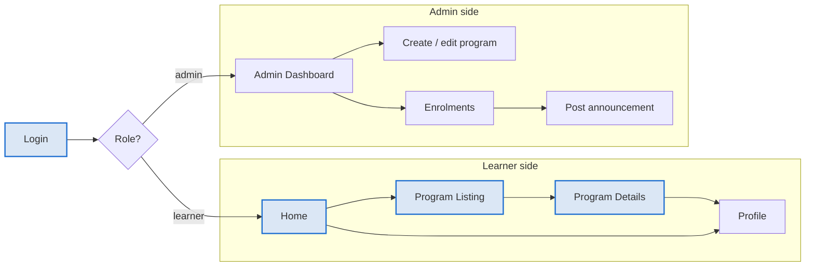

# SkillBridge

SkillBridge is a Flutter mobile app where learners find and enrol in skill-building programs, and admins publish and manage them.

## Purpose

SkillBridge puts program discovery, enrolment and program management in one mobile app, so learners and coordinators stop relying on scattered links, forms and group chats.

**The problem.** Learners who want internships, short courses or bootcamps usually find them through social media posts, WhatsApp forwards and separate websites. They lose track of deadlines and forget which programs they joined. Coordinators collect sign-ups in spreadsheets and send updates by hand.

**The solution.** SkillBridge gives learners one place to browse programs, read the details, enrol and see everything they have joined. It gives admins a simple way to publish programs, see who enrolled and post announcements.

## Objectives for Version 1

- A learner can go from opening the app to enrolling in a program in under 2 minutes.
- An admin can publish a new program from their phone without a separate website.
- Every learner can see their enrolled programs and updates on one Profile screen.

## Key features

Version 1 has ten features: five for learners and five for admins. "Must have" features are built first, and "Should have" features follow once the core works.

| Feature | User | Priority | Description |
|---|---|---|---|
| Sign up and log in | Both | Must have | Email and password account; the app shows the learner or admin side based on role |
| Browse and search programs | Learner | Must have | Scrollable list of programs with search by title and filter by category |
| Program details | Learner | Must have | Title, description, duration, skills covered, start date and deadline |
| Enrol in a program | Learner | Must have | One-tap enrolment with a confirmation message |
| Profile and my programs | Learner | Should have | Learner's details and a list of enrolled programs with their status |
| Create and edit programs | Admin | Must have | Form to add or update a program's details, and close it when full |
| View enrolments | Admin | Must have | List of learners enrolled in each program |
| Post announcements | Admin | Should have | Short updates that appear on the program's details screen |
| Admin dashboard | Admin | Should have | Summary of total programs, open programs and total enrolments |
| Log out and settings | Both | Should have | Log out and edit basic profile details |

## Screens and navigation

After login, the app checks the user's role and opens either the learner side or the admin side. Version 1 has 9 screens across the two roles.

Learners move from Home to Program Listing, open Program Details, and after enrolling find the program on their Profile. Admins work from the Dashboard to create programs, check enrolments and post announcements.

The four highlighted screens (Login, Home, Program Listing and Program Details) are the core screens built first.